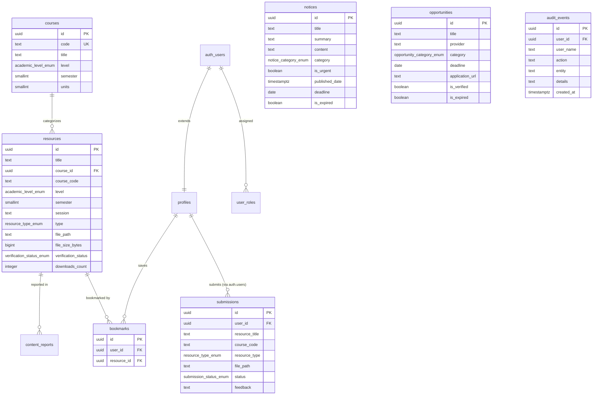

# ASSON UI Digital Infrastructure — Version 1 Technical Audit

> **Document Type**: Senior Software Architecture & Technical Audit Report  
> **Repository**: [https://github.com/emmanuelikeh2993/asson_website](https://github.com/emmanuelikeh2993/asson_website) (branch: `main`)  
> **Live Production Deployment**: [https://asson-ui.netlify.app](https://asson-ui.netlify.app)  
> **Database & Storage Host**: Supabase Cloud PostgreSQL (`cvhjohbknghlmspoaenr.supabase.co`)  
> **Audit Date**: November 2026  
> **Auditor**: Senior Software Architect & Security Auditor  
> **Scope**: Strict inspection of existing codebase, migrations, dependencies, client/server communication, data layers, and security policies.

---

## 1. Technology Stack

### 1.1 Frontend Framework & Core Runtime
- **Framework**: React 18.3.1 (`react`, `react-dom`)
- **Build Tool & Bundler**: Vite 6.0.1 (`@vitejs/plugin-react` v4.3.4)
- **Language**: TypeScript 5.6.3 (Configured via `tsconfig.json` with target `ES2020`, strict mode enabled, JSX `react-jsx`)
- **Client-Side Routing**: React Router v6.28.0 (`react-router-dom`)
- **Styling Architecture**: Tailwind CSS 3.4.16 with PostCSS 8.4.49 and Autoprefixer 10.4.20
- **Iconography**: Lucide React 0.468.0
- **Form Handling & Schema Validation**: React Hook Form 7.54.0 and Zod 3.24.1
- **Async State & Server Cache**: TanStack React Query v5.62.0 (`@tanstack/react-query`)
- **Class Utilities**: `clsx` 2.1.1, `tailwind-merge` 2.5.5

### 1.2 Backend, Database & Cloud Infrastructure
- **Backend-as-a-Service (BaaS)**: Supabase (Serverless PostgreSQL 15+ engine via `@supabase/supabase-js` v2.118.0)
- **Database Engine**: PostgreSQL 15.x with `uuid-ossp` and `pg_trgm` (trigram text indexing) extensions enabled.
- **Authentication**: Supabase Auth (Infrastructure scaffolded in DB schema; currently unutilized by frontend student/admin clients).
- **Object Storage**: Supabase Storage public bucket (`resources`), with 15MB file size limit.
- **Hosting Provider**: Netlify (Automated CI/CD linked to GitHub `main` branch).
- **Edge Routing & SPA Rewrites**: `netlify.toml` and `public/_redirects` (`/* /index.html 200`).

---

## 2. System Architecture

```mermaid
flowchart TD
    subgraph Client ["Client Browser (Mobile & Desktop)"]
        UI["React 18 SPA (Vite)"]
        LocalStorage["Browser Storage<br/>(asson_submissions, asson_downloads)"]
        SessionStorage["Session Storage<br/>(asson_admin_authenticated)"]
    end

    subgraph CDN ["Netlify Global Edge"]
        Edge["Netlify CDN (SSL / SPA Rewrites)"]
    end

    subgraph Supabase ["Supabase Cloud (PaaS)"]
        Postgres[("PostgreSQL 15 DB<br/>13 Tables + RLS")]
        Storage["Storage Bucket: 'resources'<br/>(Submissions & Documents)"]
    end

    UI <-->|HTTP GET / POST| Edge
    UI -->|Direct REST via Supabase SDK (Anon Key)| Postgres
    UI -->|Multipart Upload / CDN Stream| Storage
    UI <--> LocalStorage
    UI <--> SessionStorage
```

### 2.1 Frontend-Backend Communication
- Communication is client-to-database direct REST over HTTPS using the `@supabase/supabase-js` SDK.
- The frontend exposes a single client initialized in `src/lib/supabase.ts` using `import.meta.env.VITE_SUPABASE_URL` and `import.meta.env.VITE_SUPABASE_ANON_KEY`.
- **Dual-Layer Fallback Mechanism**: All data-fetching functions (`fetchResources`, `fetchCourses`, `fetchNotices`, `fetchOpportunities`, `fetchFaqs`) wrap network requests in `try/catch` blocks. If the remote database is unreachable or returns empty arrays, the application transparently serves static fallback datasets from `src/lib/mockData.ts`.

### 2.2 Data Ingestion & Storage
- **Academic Materials**: 
  - 625 catalogued documents are indexed in the `resources` table.
  - Files are referenced via `file_path` pointing to Supabase Storage public bucket `resources` or external verified URLs.
  - Downloads are triggered by direct client URL requests via `src/lib/download.ts`.
- **Anonymous Material Contributions**:
  - Uploaded via `src/components/features/resources/SubmitResourceModal.tsx`.
  - Sanitizes the file name, writes the binary to `resources/submissions/{timestamp}_{filename}`, and creates a record in the `submissions` table.
  - To prevent student data loss when network or RLS restrictions occur, a copy of the submission is serialized into the browser's `localStorage` (`asson_submissions`).
- **Notices & Opportunities**:
  - Queried directly from `notices` and `opportunities` tables.
  - Active notices are merged with verified local departmental seeds to prevent blank states.

### 2.3 Administrative & Moderation Operations
- The Admin Console (`src/pages/AdminPage.tsx`) provides:
  - **Telemetry Dashboard**: Pure SVG dual-line chart (`AnalyticsChart.tsx`) computing 7D/14D/30D traffic trends.
  - **Curriculum Leaderboard**: Ranked bar chart (`CourseDemandLeaderboard.tsx`) displaying download volumes per course code.
  - **Submissions Moderation**: In-memory and local queue state transitions (`Under Review` $\rightarrow$ `Approved` / `Changes Requested`).
  - **Audit Logs View**: Reads from Supabase `audit_events` table.
  - **Access Gate**: Guarded by a client-side PIN check (`2026`) stored in `sessionStorage` (`asson_admin_authenticated`).

---

## 3. Database Audit

The database schema is defined in `supabase/migrations/20261104000000_initial_schema.sql` and executed on Supabase.

### 3.1 Custom Enums
- `academic_level_enum`: `'100'`, `'200'`, `'300'`, `'400'`, `'Postgraduate'`
- `resource_type_enum`: `'Past Question'`, `'Lecture Note'`, `'Course Outline'`, `'Tutorial Sheet'`, `'Reference Material'`
- `verification_status_enum`: `'Verified'`, `'Unverified'`, `'Needs Review'`, `'Archived'`
- `user_role_enum`: `'student'`, `'editor'`, `'admin'`, `'super_admin'`
- `notice_category_enum`: `'ASSON'`, `'Department'`, `'Faculty'`, `'University'`
- `opportunity_category_enum`: `'Scholarship'`, `'Internship'`
- `submission_status_enum`: `'Under Review'`, `'Approved'`, `'Changes Requested'`

### 3.2 Schema Table Inventory



| Table Name | Primary Key | Foreign Keys | Key Constraints | Existing RLS Policies |
| :--- | :--- | :--- | :--- | :--- |
| `profiles` | `id` (UUID) | `id` $\rightarrow$ `auth.users(id)` ON DELETE CASCADE | None | Select/Update restricted to `auth.uid() = id`. |
| `user_roles` | `id` (UUID) | `user_id` $\rightarrow$ `auth.users(id)` ON DELETE CASCADE | UNIQUE(`user_id`, `role`) | Read/Write restricted to system/admin. |
| `courses` | `id` (UUID) | None | `code` UNIQUE, `semester IN (1, 2)` | Public Read (`true`). |
| `resources` | `id` (UUID) | `course_id` $\rightarrow$ `courses(id)` ON DELETE RESTRICT | None | Public can view `verification_status IN ('Verified', 'Archived')`. Editors have full access. |
| `notices` | `id` (UUID) | None | None | Public can view `is_expired = false`. Editors have full access. |
| `opportunities`| `id` (UUID) | None | None | Public can view `is_verified = true`. Editors have full access. |
| `faqs` | `id` (UUID) | None | None | Public Read (`true`). |
| `executive_contacts`| `id` (UUID) | None | None | Public Read (`true`). |
| `submissions` | `id` (UUID) | `user_id` $\rightarrow$ `auth.users(id)` ON DELETE CASCADE | None | Students can view/insert own (`auth.uid() = user_id`). Editors have full access. Public Storage policy allows public INSERT on bucket `resources`. |
| `content_reports` | `id` (UUID) | `resource_id` $\rightarrow$ `resources(id)`, `user_id` $\rightarrow$ `auth.users(id)` | None | Public can INSERT (`true`). Editors have full access. |
| `bookmarks` | `id` (UUID) | `user_id` $\rightarrow$ `auth.users(id)`, `resource_id` $\rightarrow$ `resources(id)` | UNIQUE(`user_id`, `resource_id`) | Restricted to `auth.uid() = user_id`. |
| `audit_events` | `id` (UUID) | `user_id` $\rightarrow$ `auth.users(id)` ON DELETE SET NULL | None | Admins can view (`public.has_role('admin')`). |
| `site_settings`| `key` (TEXT) | None | None | Admin managed. |

### 3.3 Database Triggers & Integrity Functions
- `public.has_role(required_role)`: Security definer SQL function checking `public.user_roles` against `auth.uid()`.
- `public.handle_new_user()`: Trigger function executing on `AFTER INSERT ON auth.users` that automatically creates a linked row in `public.profiles` and assigns the default `student` role in `public.user_roles`.
- Trigram index `idx_resources_title_trgm` on `public.resources(title gin_trgm_ops)` for fast string pattern matching.

---

## 4. Security Audit

### 4.1 Authentication & Authorization Disconnect
- **Finding**: While the database schema has enterprise-grade Row-Level Security (RLS) linked to Supabase Auth (`auth.uid()`), the frontend currently operates in **Zero-Login Mode**.
- **Impact**:
  - The frontend client only uses `VITE_SUPABASE_ANON_KEY`.
  - Because no user is signed into Supabase Auth on the client, all requests arrive at PostgreSQL with `auth.uid() IS NULL` and role `anon`.
  - As a result, database tables with policies enforcing `auth.uid() = user_id` (such as `profiles`, `bookmarks`, and server-side `submissions` requiring `auth.uid()`) will reject direct anonymous writes.
  - The frontend compensates by storing bookmarks and submissions in the browser's `localStorage`.

### 4.2 Administrative Access Gate
- **Finding**: In `src/pages/AdminPage.tsx`, administrative functions are protected by a client-side passcode (`2026`) evaluated in React state and stored in `sessionStorage`.
- **Impact**:
  - A technically proficient user can inspect client source code, discover the PIN, or manually invoke state transitions in their browser console.
  - However, because the backend database tables (`resources`, `notices`, `audit_events`) have server-side RLS requiring `public.has_role('editor')`, client-side tampering in `AdminPage` does not compromise the remote PostgreSQL database unless a valid Supabase Auth JWT with editor claims is supplied.

### 4.3 Storage Bucket Access Policies
- **Finding**: The Supabase Storage bucket `resources` has active public policies:
  - `Allow public reads from resources bucket`: Open `SELECT` for anyone.
  - `Allow public uploads into resources bucket`: Open `INSERT` for any unauthenticated client into `bucket_id = 'resources'`.
- **Impact**:
  - Allows the required zero-login file contribution workflow.
  - **Risk**: Any public user with the anonymous key can upload files up to 15MB into the bucket without rate limits or virus scanning at the storage layer.

### 4.4 Secrets & API Key Exposure
- **Finding**:
  - The repository correctly ignores `.env` in `.gitignore`.
  - The publishable key `sb_publishable_NMsNixFSbQvLjqXtGpHgxA_uuaBD7w5` is embedded in the client bundle. This is normal and standard for Supabase publishable keys.
  - No secret keys (such as `sb_secret_...` or database connection strings) are present in the frontend bundle or Git tree.

---

## 5. Deployment and Maintenance

### 5.1 Infrastructure Layout
- **Hosting Provider**: Netlify
- **Production URL**: `https://asson-ui.netlify.app`
- **SSL / TLS**: Netlify Automated Let's Encrypt Certificate (SNI).
- **Domain Configuration**: Currently on default Netlify subdomain (`.netlify.app`). No custom departmental apex domain (e.g. `asson.ui.edu.ng` or `asson-ui.org`) is bound yet.
- **Database Host**: Supabase Cloud AWS (`eu-west-1` / Central instance `cvhjohbknghlmspoaenr`).
- **Backup Mechanism**: Standard Supabase managed daily physical backups (free tier retention: 7 days).

### 5.2 Deployment Pipeline & Repository Structure
- **Continuous Deployment**: Linked to GitHub repository `emmanuelikeh2993/asson_website` on branch `main`.
- **Build Trigger**: Pushes to `main` trigger `npm run build` on Netlify Build Containers (Node v20/v22).
- **Build Output**: `dist/` directory deployed to Netlify Global Edge.
- **Maintenance Dependencies**:
  - `@supabase/supabase-js` (critical network runtime).
  - Netlify hosting account limits (100GB bandwidth/month, 300 build minutes/month on free tier).
  - Supabase free tier limits (500MB database storage, 1GB file storage, 50,000 monthly active users).

---

## 6. Version 2 Readiness Assessment

Assessment of existing infrastructure against the 12 proposed future modules:

| Module | Proposed Capability | V1 Readiness Classification | Architectural Reality in Codebase |
| :--- | :--- | :--- | :--- |
| **1. Student Identity & Membership** | Matriculation number verification, official departmental membership status, executive voting eligibility. | **Requires Modification** | Database already possesses `profiles` and `user_roles` with `matric_number`, `level`, and `department`. However, the frontend currently bypasses auth to maintain zero-login access. Requires activating Supabase Auth UI without degrading public unauthenticated access. |
| **2. Academic Calendar** | Visual semester timetable, exam schedules, lecture week tracking, countdowns. | **Ready for Extension** | `notices` table already supports `published_date`, `effective_date`, `deadline`, and `is_urgent`. The homepage urgent banner and notice board can immediately consume a dedicated calendar view. |
| **3. Events & Registration** | ASSON Week registrations, hackathons, sports week, dinner tickets. | **Requires New Infrastructure** | No `events` or `event_registrations` tables exist in `initial_schema.sql`. Requires new database migrations, capacity counters, and ticket generator logic. |
| **4. Level-Based Announcements** | Targeting notices specifically to 100L, 200L, 300L, or 400L students. | **Ready for Extension** | `academic_level_enum` is already defined in the database and utilized on courses and resources. Adding a nullable `target_level` column to `notices` will fully activate this capability. |
| **5. Student Feedback & Welfare** | Grievance reporting, course difficulty ratings, academic welfare requests. | **Ready for Extension** | `content_reports` table already exists and allows unauthenticated public insertions (`issue_type`, `description`, `status`). Can be extended to support general student welfare categories. |
| **6. Personal Student Dashboard** | Persistent study desk across devices, course tracking, GPA planning. | **Requires Modification** | Currently built as a local device locker in `DashboardPage.tsx` using `localStorage`. Transitioning to a true multi-device personal dashboard requires linking with Supabase `auth.users` sessions. |
| **7. Saved Resources** | Starred past questions, personal revision lists. | **Requires Modification** | `bookmarks` table exists in PostgreSQL with `UNIQUE(user_id, resource_id)`. Currently runs in frontend memory/localStorage because `auth.uid()` is null. Ready once optional student sign-in is enabled. |
| **8. Notifications** | Real-time push / in-app alerts for urgent departmental announcements. | **Requires New Infrastructure** | Currently relies on static badges and polling in `HomePage.tsx`. Requires Supabase Realtime WebSocket listeners (`supabase.channel()`) or browser Web Push API service workers. |
| **9. Lecturer Directory** | Departmental faculty profiles, office locations, research areas, office hours. | **Requires New Infrastructure** | Intentionally postponed in V1 specification (`project_idea.md` Section 24.2). No `lecturers` table exists. Requires a new schema table and editorial consent from faculty staff. |
| **10. Student Participation & Development** | Peer tutoring clinics, quiz competitions, academic recognition points. | **Requires Further Investigation** | Departmental Saturday tutorial notices exist in V1 seed data, but no data models exist to track student attendance, mentor-mentee pairing, or achievement badges. |
| **11. Executive & Committee Management** | Portfolio handover, internal exco communications, task delegation. | **Ready for Extension** | `executive_contacts` table exists with roles, bios, and order index. `AdminPage.tsx` already features telemetry and audit logs. Needs internal permission boundaries between committee members. |
| **12. Institutional Handover** | Seamless transfer of administrative control between student union cohorts. | **Requires Modification** | V1 relies on hardcoded passkeys in `AdminPage.tsx`. Handover requires migrating admin authentication to database-backed Supabase Auth with an invite/revocation flow for new session executives. |

---

## 7. Final Deliverables

### 7.1 Technical Architecture Summary
The ASSON UI platform is currently operating as a **High-Performance Hybrid Static-Cloud Application**:
- Public consumption is completely decentralized: static assets are served from Netlify's global edge network, while academic metadata and binaries stream directly from Supabase CDN.
- Client state is highly resilient: if the network drops or Supabase experiences cold-start latency, the application gracefully degrades to cached mock datasets without rendering blank error screens.

### 7.2 Database Schema Documentation Reference
- The complete relational schema is encapsulated in `supabase/migrations/20261104000000_initial_schema.sql`.
- Tables supporting public read: `resources`, `courses`, `notices`, `opportunities`, `faqs`, `executive_contacts`.
- Tables supporting public write: `storage.objects` (bucket `resources`), `submissions` (unauthenticated queue), `content_reports`.
- Tables reserved for authenticated roles: `profiles`, `user_roles`, `bookmarks`, `audit_events`, `site_settings`.

### 7.3 Existing Feature Inventory (Audited from Code)
1. **Public Academic Resource Explorer**: Filterable 57-course library with level pills, keyword search, and metadata slide-out drawers.
2. **Instant Direct Document Downloader**: 1-tap PDF retrieval from cloud storage without registration walls.
3. **Global Keyboard Command Palette**: Activated via `Ctrl+K` or `/` indexing all catalogued courses.
4. **Peer Material Submission Flow**: Uploads PDF/DOCX to `resources/submissions/` and generates local tracking reference.
5. **Mobile-First Layout**: Slide-out hamburger navigation drawer, sticky 5-tab thumb bar (`pb-safe`), and horizontal course swipe slider.
6. **Executive Telemetry Hub**: Interactive SVG cubic-bezier line graph (Material Downloads vs. Student Sessions over 7D/14D/30D) and Curriculum Demand Leaderboard with visual progress meters.
7. **Administrative Moderation Console**: Submissions review queue with revision feedback dispatching.
8. **Institutional Announcement Board**: Categorized feed with urgent Senate/examination alert trays.
9. **Scholarship & Career Board**: Hand-vetted grants and quantitative SIWES internships with external application links.
10. **Device Study Locker**: Client-side dashboard tracking recent downloads and submission statuses via `localStorage`.

### 7.4 Security & Maintenance Concerns
1. **Client-Side Admin Passkey**: The `/admin` console authentication is currently client-side (`sessionStorage`). While remote database tables remain protected by RLS, this must be upgraded to real Supabase Auth before delegating admin credentials to student executives.
2. **Unmetered Public Storage Uploads**: The storage bucket `resources` allows public anonymous inserts. Malicious clients could script spam uploads. File size is bounded to 15MB, but a rate-limiting Edge Function or CAPTCHA should be introduced in Version 1.1.
3. **Data Parity Between Local & Remote**: Student submissions and bookmarks currently write to `localStorage` when unauthenticated. If a student clears browser cookies/cache, their submission history on that device is wiped.

### 7.5 Version 2 Implementation Dependencies
To cleanly transition to Version 2 without breaking Version 1:
1. **Introduce "Optional" Supabase Auth**:
   - Provide an optional "Sign in with Student Email" modal.
   - If signed in: Sync bookmarks and submissions to PostgreSQL `bookmarks` and `submissions` tables.
   - If not signed in: Maintain existing seamless zero-login browsing and download capabilities.
2. **Edge Function for Announcement Ingestion**:
   - Create a webhook endpoint in Supabase Functions to allow ASSON WhatsApp/Telegram announcement bots to automatically post to the `notices` table.
3. **Custom Domain Binding**:
   - Assign a custom domain (e.g. `asson-ui.org` or `asson.ui.edu.ng`) on Netlify DNS with HTTPS certificates.

### 7.6 Recommendations for Preserving Existing Functionality
- **Maintain Zero-Barrier Public Reading**: Never place the Past Questions or Resource Explorer behind a mandatory login wall. Public, open retrieval is the core reason for the platform's high adoption.
- **Preserve Fallback Dataset Architecture**: Keep `MOCK_RESOURCES` and `COURSES` in `src/lib/mockData.ts` in sync with the database. This guarantees the platform never displays blank screens during university network throttling.
- **Retain Pure SVG Visualizations**: Avoid importing heavy JavaScript charting packages (Chart.js, Recharts). The existing pure SVG `AnalyticsChart.tsx` delivers zero-bundle-bloat performance suitable for low-bandwidth mobile connections.
