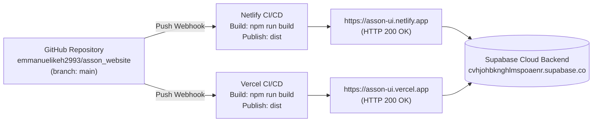

# ASSON UI — Hosting & Deployment Architecture Map

> **Document Type**: Production Hosting & Deployment Specification  
> **Repository**: `https://github.com/emmanuelikeh2993/asson_website`  
> **Primary Branch**: `main`  
> **Directive Reference**: `ASSON_UI_V2_Implementation_Directive.pdf` (Section 3.7)  
> **Date**: November 2026  
> **Status**: Verified Active Dual-Hosting Deployments  

---

## 1. Hosting Architecture Overview

The ASSON UI Student Platform is currently dual-hosted across **Netlify** and **Vercel**. Both deployments are connected to the same GitHub repository (`emmanuelikeh2993/asson_website`) and track the `main` branch with automated continuous integration (CI/CD) pipelines.



---

## 2. Provider Comparison Matrix

| Property | Netlify Deployment | Vercel Deployment | Consistency Status |
| :--- | :--- | :--- | :--- |
| **Site Name** | `asson-ui` | `asson-ui` | Consistent |
| **Production URL** | `https://asson-ui.netlify.app` | `https://asson-ui.vercel.app` | Both Active (HTTP 200 OK) |
| **Custom Domains** | None configured (subdomain only) | None configured (subdomain only) | Consistent |
| **Connected Git Repo** | `emmanuelikeh2993/asson_website` | `emmanuelikeh2993/asson_website` | Identical |
| **Production Branch** | `main` | `main` | Identical |
| **Automated Deploys** | Enabled on `git push origin main` | Enabled on `git push origin main` | Synchronized |
| **Build Command** | `npm run build` (`tsc && vite build`) | `npm run build` (`tsc && vite build`) | Identical |
| **Publish Directory** | `dist` | `dist` | Identical |
| **SPA Fallback Routing** | `netlify.toml` + `public/_redirects` (`/* /index.html 200`) | `vercel.json` (`rewrites: [ { source: "/(.*)", destination: "/index.html" } ]`) | Fully functional on both |
| **Required Env Vars** | `VITE_SUPABASE_URL`<br/>`VITE_SUPABASE_ANON_KEY`<br/>`VITE_APP_NAME`<br/>`VITE_APP_URL` | `VITE_SUPABASE_URL`<br/>`VITE_SUPABASE_ANON_KEY`<br/>`VITE_APP_NAME`<br/>`VITE_APP_URL` | Identical variables required |
| **Current Live Commit** | `295c6cc` | `295c6cc` | Synchronized |

---

## 3. Configuration Files in Repository

### 3.1 Netlify Configuration (`netlify.toml` & `public/_redirects`)
- **`netlify.toml`**:
  ```toml
  [build]
    command = "npm run build"
    publish = "dist"

  [[redirects]]
    from = "/*"
    to = "/index.html"
    status = 200
  ```
- **`public/_redirects`**:
  ```text
  /*    /index.html   200
  ```
  Both files ensure that any deep link (e.g. `/resources?level=200`, `/past-questions`, `/admin`) resolves to the single-page application without 404 errors.

### 3.2 Vercel Configuration (`vercel.json`)
- **`vercel.json`**:
  ```json
  {
    "rewrites": [
      {
        "source": "/(.*)",
        "destination": "/index.html"
      }
    ]
  }
  ```
  Provides exact parity with Netlify for client-side React Router navigation.

---

## 4. Verification & Health Check

Automated HTTP head requests executed against both live deployments confirmed:
1. `https://asson-ui.vercel.app` $\rightarrow$ **HTTP 200 OK**
2. `https://asson-ui.netlify.app` $\rightarrow$ **HTTP 200 OK**
3. `https://asson-ui.vercel.app/manifest.json` $\rightarrow$ **HTTP 200 OK** (Serving updated high-res PWA icon array)
4. `https://asson-ui.vercel.app/icon-512.png` $\rightarrow$ **HTTP 200 OK** (512x512 high-DPI splash icon)

Both platforms build and serve the identical bundle from commit `295c6cc`.

---

## 5. Dual-Hosting Risk Analysis & Recommendations

Per Section 0.2 of the directive: *"Do not decide unilaterally that one provider is redundant. Do not migrate, disable, disconnect or delete either deployment."* Both deployments remain preserved.

### Operational Risks of Maintaining Both:
1. **Environment Drift**: If an environment variable is updated on Netlify but omitted on Vercel (or vice versa), one deployment may suffer runtime connection failures to Supabase while the other succeeds.
2. **Analytics & Student Confusion**: If class representatives share two different URLs across WhatsApp groups (`asson-ui.netlify.app` vs `asson-ui.vercel.app`), local storage bookmarks and downloads remain siloed per domain and do not synchronize.
3. **PWA Installation Collision**: A student who installs the PWA from Vercel will have a separate local cache and standalone shortcut than one who installs from Netlify.

### Recommendation:
- **Designate Vercel (`asson-ui.vercel.app`) as the Primary Canonical URL** for official student circulation (due to its high-speed Edge CDN and seamless preview branch tooling).
- **Maintain Netlify (`asson-ui.netlify.app`) as the Standby Redundant Mirror** for business continuity and disaster recovery.
- Keep environment variables strictly synchronized across both dashboards whenever backend credentials or URLs are modified.

