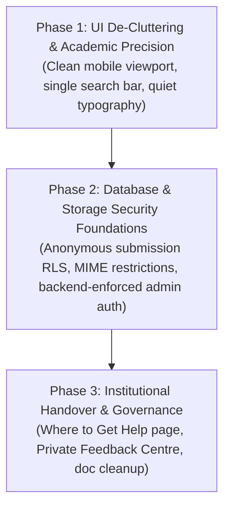

# ASSON UI — V2 Implementation Plan

> **Directive Reference**: `ASSON_UI_V2_Implementation_Directive.pdf`  
> **Repository**: `https://github.com/emmanuelikeh2993/asson_website` (branch: `main`)  
> **Live Deployments**: [asson-ui.vercel.app](https://asson-ui.vercel.app) (Primary) & [asson-ui.netlify.app](https://asson-ui.netlify.app) (Mirror)  
> **Objective**: Streamline the user interface to eliminate visual clutter, harden backend security and data boundaries, and fulfill the association's manifesto commitments without disturbing working features.

---

## 1. Problem Statement & Reviewer Feedback Analysis

### Reviewer Feedback: *"The app is noisy / cluttered."*
Reviewers (students and peers testing the live platform) reported that the interface feels noisy, busy, and over-packed. An architectural and UX analysis confirms four specific root causes:

1. **Mobile Viewport Cannibalization**: The sticky top navbar (64px) plus the fixed bottom navigation bar (60px) plus the PWA install prompt consume **over 35% of the mobile screen height**.
2. **Four Competing Navigation Triggers in the Hero**: Students are simultaneously presented with:
   - Level pills (`100L`, `200L`, `300L`, `400L`, `PG`)
   - Search bar with ⌘K badge and green "Search" button
   - Trending course tags (`STA 111`, `STA 211`, `STA 231`, `MAT 121`)
   - Two large CTA buttons (`Explore Past Questions` & `Submit Material`)
3. **Marketing SaaS Cards**: The 4-box statistics grid (*"625+ Catalogued Materials"*, *"57 Departmental Courses"*, *"100% Free Instant Access"*, *"Zero Login Walls"*) and the "Academic Gateways" bento cards push the actual academic materials below the fold.
4. **Visual Over-Stimulation**: Simultaneous glowing gradient text, dot-grid overlays, animated pulse dots, and loud red warning banners compete for attention.

### Core Product Principle (Section 1.1 of Directive):
> **"Academic Precision meets Modern SaaS."** It must feel authoritative, clean, and blazingly fast. No bloated page-load animations, no layout shifts, and no heavy client-side JavaScript. Students must be able to search for their course code (`STA 211`, `STA 111`) and view/preview materials in **under 5 seconds**.

---

## 2. Phased Implementation Roadmap

---

## 3. Phase 1: UI De-Cluttering & Academic Precision (Immediate Priority)

### Step 1.1: Mobile Navigation Streamlining
- **Audit Issue**: Having both a dense sticky top navbar AND a fixed bottom navigation bar causes double-chrome crowding on mobile.
- **Action**:
  - Keep the top navbar clean and compact: Logo + Title + Search icon + Hamburger menu.
  - Simplify `MobileNav.tsx`: Remove the oversized floating center circle button that overlaps content. Provide clean, flush tabs (`Home`, `Past Questions`, `Notices`, `Opportunities`).
  - Move "Submit Material" into a clean header action and inside the mobile drawer, preventing persistent screen obstruction.

### Step 1.2: Redesign the Hero into a Focused Academic Search Console
- **Audit Issue**: The hero section has 4 competing jump mechanisms, SaaS stat cards, and marketing copy.
- **Action**:
  - **Single Authoritative Search Bar**: Prominent, high-contrast, autofocus-ready search input.
  - **Clean Integrated Level Chips**: Directly below the search bar, provide minimalist academic level chips (`100L`, `200L`, `300L`, `400L`, `Postgraduate`) that instantly filter the catalog without reloading.
  - **Remove SaaS Metric Boxes**: Remove the 4 stat cards (*"625+ Materials"*, *"57 Courses"*, etc.) from the mobile hero so verified course papers appear immediately on the first scroll.
  - **Quiet Background**: Replace the busy dot-grid background with a deep, calm, academic green surface that offers maximum contrast and zero visual distraction.

### Step 1.3: Elevate Content Above the Fold
- **Audit Issue**: Students must scroll past 3 screens of marketing bento cards before seeing actual past questions.
- **Action**:
  - Replace the "Academic Gateways" marketing cards with a **Quick Course Grid / Recent Past Papers** list.
  - Display clean, high-density resource rows: course code badge (`STA 211`), examination session (`2023/2024`), resource type (`Past Question`), direct Preview button, and one-tap Download.
  - Ensure zero layout shifts during data loading using our existing shimmer skeletons (`ResourceCardSkeleton`).

### Step 1.4: Refine the Urgent Announcement Presentation
- **Audit Issue**: The urgent notice banner currently overlaps the hero with a loud red border and duplicate "Read it please." labels.
- **Action**:
  - Convert urgent announcements into an elegant, non-intrusive notification pill at the top of the content area.
  - Clear, legible title and date, linking directly to the full notice on `/notices`.

---

## 4. Phase 2: Database & Storage Security Foundations

### Step 2.1: Anonymous Student Submission Pipeline
- **Audit Issue**: Database `submissions` table requires `auth.uid() = user_id`, which fails for unauthenticated students and falls back to `localStorage`.
- **Action**:
  - Create a migration to allow nullable `user_id` on `submissions`.
  - Add a unique `reference_code TEXT` column (e.g. `SUB-2026-XXXXX`) generated upon upload.
  - Configure Postgres RLS:
    - Public can `INSERT` submissions with strict schema validation.
    - Public `SELECT` is restricted (students look up only their own receipt code or use local storage).
    - Editors (`has_role('editor')`) have full `SELECT`, `UPDATE`, and `DELETE` access.

### Step 2.2: Storage Bucket Hardening
- **Audit Issue**: The Supabase `resources` bucket has open public `INSERT` without server-side MIME type or extension checks.
- **Action**:
  - Restrict storage upload policies to verified academic document extensions: `pdf`, `docx`, `zip`.
  - Partition storage paths:
    - `submissions/`: Quarantined unreviewed student uploads.
    - `published/`: Approved public materials accessible for fast CDN streaming.

### Step 2.3: Executive Admin Authentication Upgrade
- **Audit Issue**: `/admin` is gated only by client-side JavaScript (`sessionStorage.getItem('asson_admin_authenticated')`).
- **Action**:
  - Replace the client-side passkey check with **Supabase Auth** (email magic link or password-based executive login).
  - Verify `has_role('editor')` or `has_role('admin')` server-side via Supabase JWT on every moderation mutation.
  - Purge the exposed passkey from all tracked documents and Git history notes.

---

## 5. Phase 3: Institutional Handover & Governance

### Step 3.1: "Where to Get Help" Directory (`/help`)
- **Directive Requirement (Section 5.3)**: Implement an easy-to-find page connecting students to verified support channels:
  - Academic Course Advisers (100L–400L staff advisers).
  - Departmental Enquiries (HOD office, General Office location & hours).
  - Student Welfare Concerns (ASSON Welfare Board contacts).
  - Platform Technical Support & Broken Link Reporting.
- Only verified UI contacts and locations will be displayed; no fabricated placeholders.

### Step 3.2: "Private Feedback Centre"
- **Directive Requirement (Section 5.4)**: Private, focused student feedback and issue reporting:
  - Categories: General Feedback, Broken Link/Material Issue, Suggestion, Welfare.
  - Strict write-only RLS policy (public can insert, but only designated Welfare Board / Admins can read).
  - Zero exposure to public search, public tables, or external AI services.

### Step 3.3: Repository Governance & Documentation Cleanup
- **Directive Requirement (Section 4)**:
  - Verify all useful architectural notes have been preserved in `docs/`.
  - Safely remove the superseded `what_i_have_done.md` from the tracked repository.
  - Maintain `.env.example` with clean placeholders and zero committed secrets.

---

## 6. Verification & Acceptance Criteria

### For Phase 1 (UI De-Cluttering):
- [ ] Mobile landing screen displays the search bar and level chips within the first viewport without scrolling.
- [ ] No double-chrome crowding (top bar and bottom bar feel unified and light).
- [ ] First batch of verified past questions is visible above or within 1 scroll of the fold.
- [ ] Search response remains snappy and debounced ($\le 250\text{ms}$).
- [ ] Zero TypeScript errors, passing production build (`npm run build`).
- [ ] Both Vercel (`asson-ui.vercel.app`) and Netlify (`asson-ui.netlify.app`) deploy cleanly and respond HTTP 200 OK.

